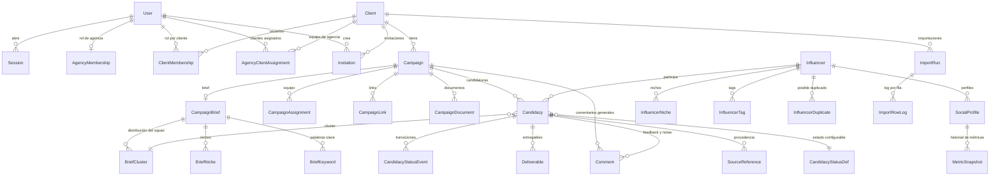

# Modelo de datos

## Diagrama

## Las tres decisiones que sostienen el modelo

### 1. El influencer existe una sola vez

`Influencer` es global de la agencia y **no tiene `clientId`**. Lo que pertenece a una campaña vive en
`Candidacy`. Así, el mismo creador participa de varias campañas de varios clientes sin duplicarse y sin
que un cliente vea el trabajo del otro.

| Dato | Dónde vive | Por qué |
| --- | --- | --- |
| Nombre, país, idioma, nichos, contacto | `Influencer` | Es de la persona, no de una campaña |
| Seguidores, ER, links | `SocialProfile` + `MetricSnapshot` | Cambian con el tiempo y tienen fuente |
| Estado, presupuesto, entregables, feedback, shortlist | `Candidacy` | Sólo tienen sentido dentro de una campaña |

### 2. Todo lo del tenant lleva `clientId` y una clave foránea compuesta

`Campaign` declara `@@unique([id, clientId])`. Las entidades hijas referencian
`(campaignId, clientId) → Campaign(id, clientId)`. Consecuencia: **la base impide por sí sola** que una
candidatura del cliente A cuelgue de una campaña del cliente B, aunque la aplicación se equivoque.

Lo mismo con `Candidacy @@unique([id, clientId])` y `BriefCluster @@unique([id, clientId])`, que sostienen
las FK de `CandidacyStatusEvent`, `Deliverable`, `Comment` y la asignación de cluster.

### 3. Las métricas no se pisan

`SocialProfile` guarda el último valor conocido **y** el texto original (`followersRaw`). Cada lectura
nueva deja un `MetricSnapshot` con fuente, URL de fuente y fecha. `SourceReference` responde
"¿de dónde salió este número?" para cada dato.

Cuando `measuredAt` tiene más de 45 días (`STALE_METRIC_DAYS`), la interfaz muestra el dato como
desactualizado en vez de presentarlo como si fuera fresco.

## Normalización de valores sucios

El Excel trae `78,9k`, `10 k`, `7,2M`, `176.000`, `42,327`, `A verificar`, `83.4`, `Likes ocultos`.

- `followers` — entero normalizado, o `NULL`.
- `followersRaw` — el texto tal cual venía. Nunca se pierde.
- `followersUnparsed` — `true` cuando había algo escrito pero no se pudo interpretar sin inventar.

`83.4` sin sufijo es ambiguo (¿83.400 u 83,4 mil?): se marca como no normalizable y se reporta.
Ver `src/lib/domain/normalize.ts` y sus tests.

## Estados configurables

Los 15 estados de una candidatura viven en `candidacy_status_defs`, no en un `enum` del código.
`CANDIDACY_STATUS_SEED` es la semilla inicial, editable desde configuración. Cada estado declara si es
visible para el cliente y si es terminal.

## Bloqueo optimista

`Client`, `Campaign`, `CampaignBrief`, `Influencer` y `Candidacy` llevan `version`. Toda edición hace
`updateMany({ where: { id, version }, data: { ..., version: { increment: 1 } } })`; si no afecta filas,
se responde `409` con "el registro cambió mientras lo editabas". Dos personas no se pisan en silencio.

## Índices

- `candidacies (clientId, campaignId, statusKey)` y `(clientId, campaignId, clientApproval)` — tabla y funnel.
- `candidacies (campaignId, inShortlist, shortlistOrder)` — shortlist ordenada.
- `social_profiles (platform, urlNormalized)` y `(platform, handle)` — detección de duplicados.
- `social_profiles (followers)` — filtro por rango.
- `audit_logs (occurredAt)`, `(clientId, occurredAt)`, `(entityType, entityId)`, `(actorUserId, occurredAt)`.
- `metric_snapshots (socialProfileId, capturedAt)` — historial.

## Dinero

`Decimal(14,2)` en base, expuesto como número en los DTO y formateado con `Intl.NumberFormat` en
`es-AR` con la moneda de la campaña o la candidatura. Nunca se muestra un importe sin su moneda.
