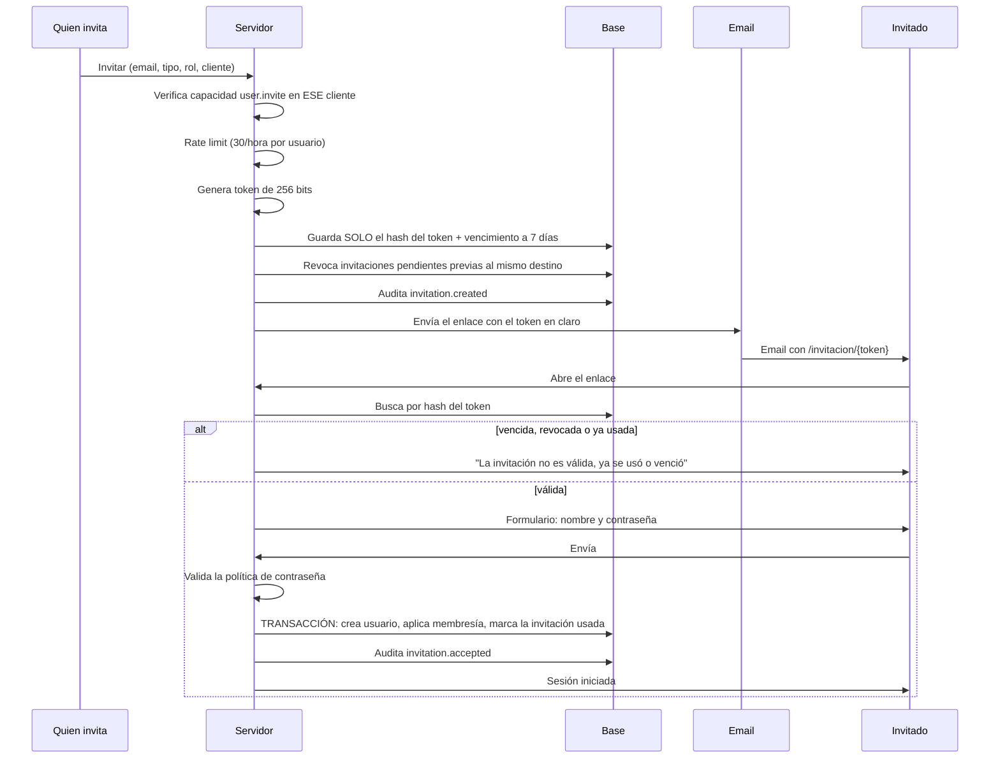

# Invitaciones y acceso

**No hay registro público.** La única forma de entrar es una invitación creada por alguien autorizado.

## El ciclo completo

## Garantías

| Requisito | Cómo se cumple |
| --- | --- |
| Token único | 32 bytes de `crypto.randomBytes` en base64url |
| Un solo uso | Al aceptar, `status` pasa a `ACCEPTED`; el estado se verifica dentro de la transacción |
| Vencimiento | 7 días (`INVITATION_TTL_MS`); vencida se marca `EXPIRED` y deja de servir |
| Verificación del email | Recibir el token en esa casilla **es** la verificación; el email no se puede cambiar al aceptar |
| Revocable | `Revocar` desde `Usuarios`; el enlace muere al instante |
| No se guarda en claro | En base sólo va `sha256(token)`. Robar la base no da tokens usables |
| Sin enumeración | Todo motivo de fallo devuelve exactamente el mismo mensaje |
| Rate limit | 30 invitaciones por hora por usuario, 10 intentos de aceptación por IP cada 15 minutos |

## Quién puede invitar a quién

- **Administrador de agencia / superadministrador**: a empleados de agencia y a usuarios de cualquier cliente.
- **Cualquier rol de agencia con `user.invite` otorgado**: sólo a usuarios de los clientes que tenga asignados.
- **Administrador del cliente**: sólo a su propia empresa, sólo con roles de cliente, y **sólo si** la agencia
  activó `allowClientUserInvites` para ese cliente.
- **Nadie** puede otorgar una capacidad que no tiene.
- **Sólo un superadministrador** puede crear otro superadministrador.

## Recuperación de acceso

1. `/recuperar` → email. La respuesta es idéntica exista o no la cuenta.
2. Si existe y está activa, se manda un enlace que vence en **una hora** y sirve **una sola vez**.
3. Al completarla, se **cierran todas las sesiones abiertas** de esa persona.

## Desactivar a alguien

`Usuarios` → `Desactivar`. En el acto:

- `status` pasa a `DISABLED` y se registra quién y cuándo.
- Se revocan **todas** sus sesiones: la cookie que tenga abierta deja de servir sin esperar a que expire.
- No puede volver a iniciar sesión.
- **Su historial se conserva**: comentarios, transiciones de estado y auditoría siguen atribuidos a esa persona.

Un cambio de rol o de membresía también revoca las sesiones, para que el alcance se recalcule al reingresar.

## Sesiones

| Propiedad | Valor |
| --- | --- |
| Cookie | `jc_session`, `HttpOnly`, `SameSite=Lax`, `Secure` en producción, `Path=/` |
| Token | 256 bits aleatorios; en base sólo el `sha256` |
| Duración | 12 horas |
| Revocación | Individual o masiva, inmediata, desde base |
| CSRF | Token derivado por HMAC del token de sesión (double-submit firmado) + validación de `Origin` |
